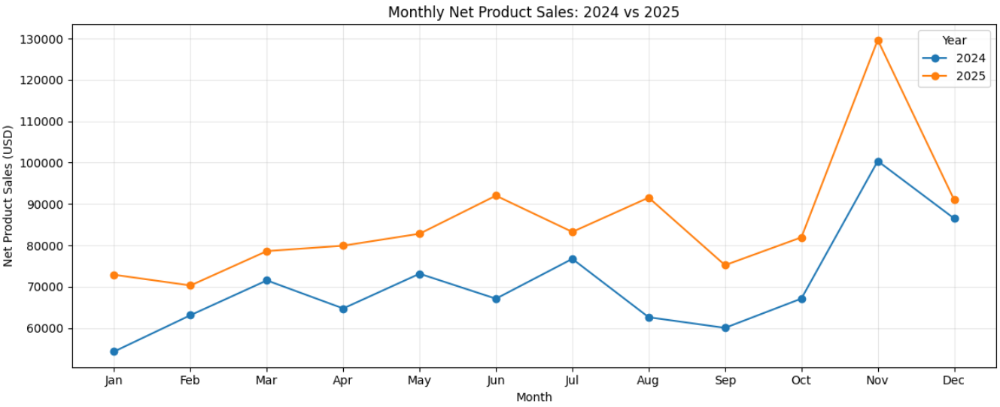
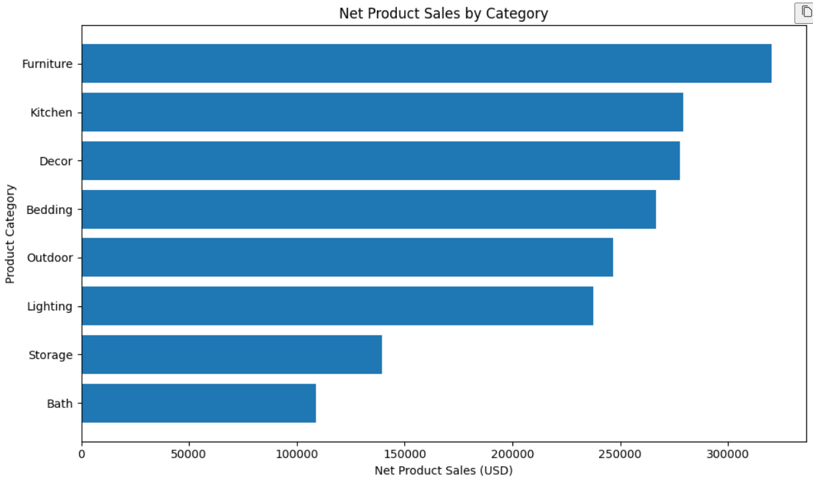
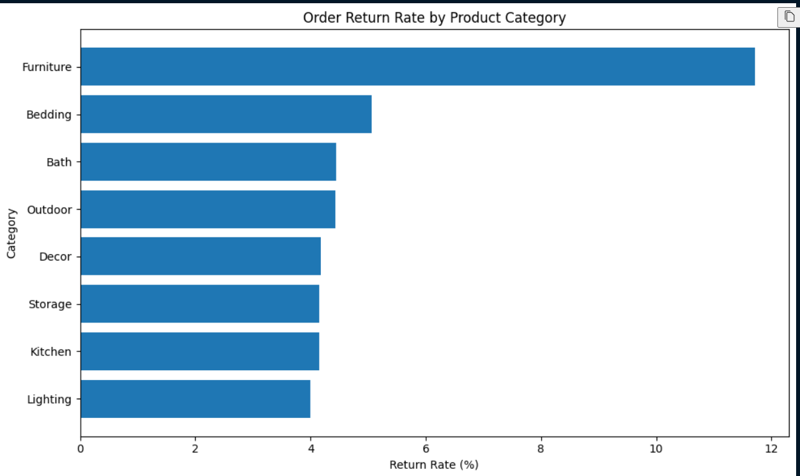
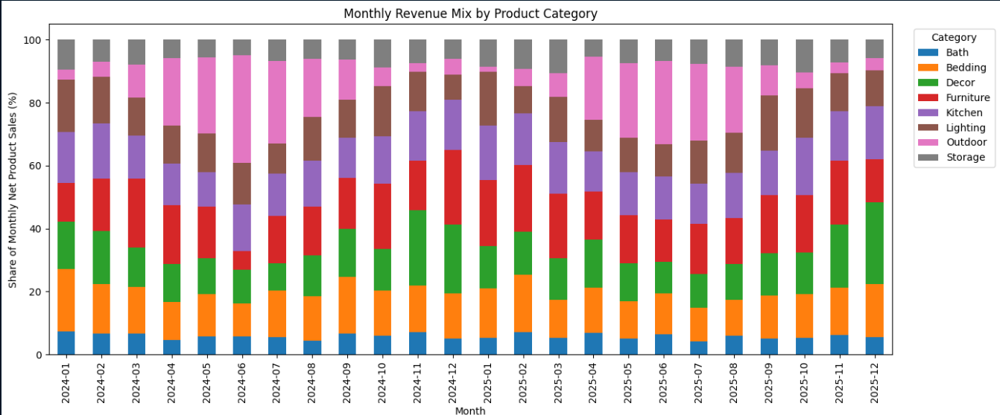

<div align="center">

# Wayfair E-commerce Sales Analysis

**Two-Year Sales Performance Review | 2024–2025**

A Python-based analysis of e-commerce orders to evaluate sales growth, category performance, product-level return risks, and opportunities for the next planning cycle.


</div>

---

## Table of Contents

- [Project Overview](#project-overview)
- [Business Questions](#business-questions)
- [Dataset](#dataset)
- [Tools and Methods](#tools-and-methods)
- [Data Quality and Cleaning](#data-quality-and-cleaning)
- [Metric Definitions](#metric-definitions)
- [Key Findings](#key-findings)
- [Visual Analysis](#visual-analysis)
- [Business Recommendations](#business-recommendations)
- [Limitations](#limitations)
- [Repository Structure](#repository-structure)
- [Reproducibility](#reproducibility)

## Project Overview

Wayfair's e-commerce team needs a clear review of online sales performance in 2024 and 2025 to inform the next annual plan. The supplied data includes order records, order-item lines, product attributes, and customer information. Before analysis, the data was profiled for missing values, duplicate records, date-format issues, and inconsistent product-category labels.

This project uses Python and Pandas to prepare the data, calculate net product sales, compare monthly performance, evaluate category and product contribution, and investigate return and cancellation patterns. The analysis focuses on turning the results into practical, evidence-led recommendations.

## Business Questions

- How did net product sales change between 2024 and 2025?
- Which months had the highest sales, and what patterns appear across the two years?
- Which product categories and products contributed the most sales?
- Which categories had the highest associated-order return and cancellation rates?
- How did category sales mix change from month to month?
- Which issues should be investigated before next year's planning decisions?

## Dataset

The analysis uses four CSV files covering orders placed between January 2024 and December 2025.

| File | Grain | Relevant fields |
|---|---|---|
| `orders.csv` | One row per order | Order date, status, customer, payment method, discount code, shipping fee |
| `order_items.csv` | One row per product line | Product, quantity, unit price, line discount |
| `products.csv` | One row per product | Product name, category, list price, unit cost |
| `customers.csv` | One row per customer | Signup date, state, acquisition channel |

The supplied files contained 9,245 order rows, 15,608 order-item rows, 90 products, and 3,600 customer records before cleaning.

## Tools and Methods

- Python, Pandas, NumPy, and Matplotlib
- Data profiling and missing-value checks
- Datetime parsing and validation
- Exact-duplicate detection
- Product-category label normalization
- Historical-price imputation using a documented date-gap rule
- DataFrame joins, grouping, aggregation, and pivot tables
- Monthly trend and year-over-year analysis
- Category revenue share, associated-order return and cancellation rates, and category sales-per-order analysis
- Business interpretation and recommendation development

## Data Quality and Cleaning

### Order dates

The source contained day-first date strings, including values such as `13-01-2024 06:39`. Dates were parsed into Pandas datetime values using day-first interpretation, and invalid parsed values were inspected rather than automatically deleted.

### Duplicate order records

The orders table contained 38 exact duplicate rows. Since the table is defined as one row per order, one copy of each exact duplicate was retained.

| Check | Rows |
|---|---:|
| Original order rows | 9,245 |
| Exact duplicate rows removed | 38 |
| Rows after exact deduplication | 9,207 |

Deduplication was based on exact row equality, not merely on repeated `order_id` values.

### Product-category labels

Category values contained inconsistent capitalization and whitespace. These labels were trimmed and standardized, consolidating the product catalog into eight categories: Bath, Bedding, Decor, Furniture, Kitchen, Lighting, Outdoor, and Storage.

### Missing unit prices

There were 199 missing `unit_price` values in the order-item data. Historical prices for the same product were investigated. A price from the nearest available transaction was used as an estimate when the reference transaction was within seven days of the order date.

| Price handling | Rows |
|---|---:|
| Originally missing unit prices | 199 |
| Prices imputed under the seven-day rule | 162 |
| Prices left missing | 37 |

The seven-day cutoff is an analytical assumption, not a verified pricing rule. Imputed prices are estimates and may not match the original transaction price, particularly around promotions or price changes. The 37 unresolved values were left missing rather than replaced with zero.

### Missing discount codes

Missing discount codes were retained as missing during initial inspection. They were not automatically interpreted as proof that no promotion was applied.

## Metric Definitions

### Net product sales

The line-level calculation is:

`Net Line Sales = Quantity × Unit Price − Discount Amount`

The primary sales trend includes orders whose final status is `completed`. Orders marked `canceled` or `returned` are excluded from this completed-order sales measure. Shipping fees are excluded.

The figures reported here are **calculated net product sales**, not profit or exact refund-adjusted revenue. Rows with unresolved unit prices do not contribute a known line-sales value to the sum, so reported sales may be understated. Historical-price imputation introduces additional uncertainty.

### Year-over-year growth

`YoY Growth (%) = (Current-Year Sales − Prior-Year Sales) / Prior-Year Sales × 100`

Monthly comparisons match each calendar month in 2025 with the same month in 2024.

### Category revenue share

`Category Revenue Share (%) = Category Net Product Sales / Total Net Product Sales × 100`

Revenue share describes the composition of calculated sales. A category's share can change even when its absolute sales move in a different direction.

### Return and cancellation rates

An order is associated with a category when at least one item in that order belongs to that category. For each category, the associated-order return or cancellation rate is the number of unique associated orders with that status divided by the number of unique orders associated with that category.

An order containing products from multiple categories may be counted in more than one category. These rates are category-associated order rates; they do not establish which item caused a return.

### Category sales per associated completed order

`Category Sales per Associated Completed Order = Category Net Product Sales / Unique Completed Orders Associated with the Category`

Because an order may contain products from multiple categories, category order counts can overlap. This metric is not a mutually exclusive allocation of the full basket value to a single category.

## Key Findings

### 1. Calculated net product sales grew by 21.45%

| Metric | Result |
|---|---:|
| 2024 net product sales | $847,438.74 |
| 2025 net product sales | $1,029,243.54 |
| Absolute change | +$181,804.80 |
| Year-over-year growth | +21.45% |

Every corresponding month in 2025 had higher calculated sales than the same month in 2024. November was the strongest month in both years, at approximately $100.4K in 2024 and $129.7K in 2025.

This repeated peak is worth investigating for planning, but two years of observations are not enough to establish a stable long-term seasonal pattern.

### 2. Furniture led category sales and had the highest associated-order return rate

Furniture generated approximately $320,305.87 in calculated net product sales, representing 17.07% of category sales in the analysis. Its category-associated return rate was 11.72%, the highest among the eight categories.

At product level, Stoneware Bar Stool had a 19.75% associated-order return rate, with 16 returned orders among 81 associated orders. Other Furniture products with elevated rates included Linen Loveseat, Nordic Storage Bench, Modern Writing Desk, Linen TV Stand, and Linen Accent Chair.

These results identify products for investigation; they do not establish the reasons for returns or quantify the financial cost of those returns.

### 3. December Furniture sales declined while total December sales increased

Furniture's calculated net product sales fell from $20,539.09 in December 2024 to $12,613.63 in December 2025, a decline of approximately 38.59%. Overall calculated December net product sales rose from $86,517.00 to $91,039.54, an increase of approximately 5.23%.

The product-level analysis showed lower December 2025 sales for products including Classic Dining Chair Pair and Nordic Side Table. Availability, listing status, demand, and promotion history are useful areas to investigate, but the available data does not establish the cause of the decline.

## Visual Analysis

### Monthly net product sales: 2024 vs. 2025



The line chart compares corresponding months and highlights the November sales peak in both years.

### Net product sales by category



Furniture generated the highest calculated category sales, followed by Kitchen and Decor.

### Return rate by category



Furniture had the highest category-associated order return rate in the analysis.

### Monthly category mix



The stacked chart shows how each category's share of calculated monthly net product sales changed over the two-year period.

## Business Recommendations

### 1. Investigate Furniture returns

Review product-level return rates and returned-order volumes, then examine actual return reasons. Prioritize products with both elevated rates and meaningful return volumes. Depending on the evidence, corrective actions could include supplier quality checks, packaging improvements, or clearer product dimensions and descriptions.

**Measures to monitor:** product- and category-associated return rates, returned sales value, and contribution margin after returns.

### 2. Investigate the December performance of selected Furniture products

Audit inventory availability, website listing status, product-page traffic, conversion, and promotion history for Linen Accent Chair and Nordic Side Table. Compare December 2025 with December 2024 before deciding whether to adjust availability, merchandising, or promotions.

**Measures to monitor:** orders, units sold, conversion rate, and net product sales.

## Limitations

- The sales figures are provisional because 162 prices were imputed and 37 prices remained missing.
- Historical-price imputation may not reproduce the original transaction price.
- Order status does not provide actual refund amounts or return reasons.
- Category-associated order rates can overlap when an order contains items from multiple categories.
- Product-associated return rates do not prove that a specific product caused an order to be returned.
- Inventory, stock-out history, website traffic, conversion, and promotion-calendar data were not supplied.
- Profit, contribution margin, and exact refund-adjusted revenue cannot be established from the available fields and analysis.
- Two years of observations are insufficient to confirm long-term seasonality.

## Repository Structure

```text
wayfair-ecommerce-sales-analysis/
├── README.md
├── wayfair_sales_analysis.ipynb
├── data/
│   ├── orders.csv
│   ├── order_items.csv
│   ├── products.csv
│   └── customers.csv
└── images/
    ├── monthly-revenue-trend.png
    ├── category-revenue.png
    ├── category-return-rate.png
    └── monthly-category-mix.png
```

## Reproducibility

Install the required packages:

```bash
pip install pandas numpy matplotlib jupyter
```

Place the four CSV files in the `data/` directory, open `wayfair_sales_analysis.ipynb` in Jupyter Notebook or VS Code, and run the notebook from top to bottom. If the notebook uses different file paths or filenames, update this section to match the repository.

## Conclusion

The analysis indicates that calculated net product sales increased in 2025, while Furniture combined the largest category sales contribution with the highest associated-order return rate. The decline in December sales for selected Furniture products also warrants further investigation.

The next planning cycle should prioritize understanding Furniture returns and validating the drivers behind the selected products' December performance. The remaining missing prices and the effect of imputation should be reviewed before the sales estimates are treated as final.
